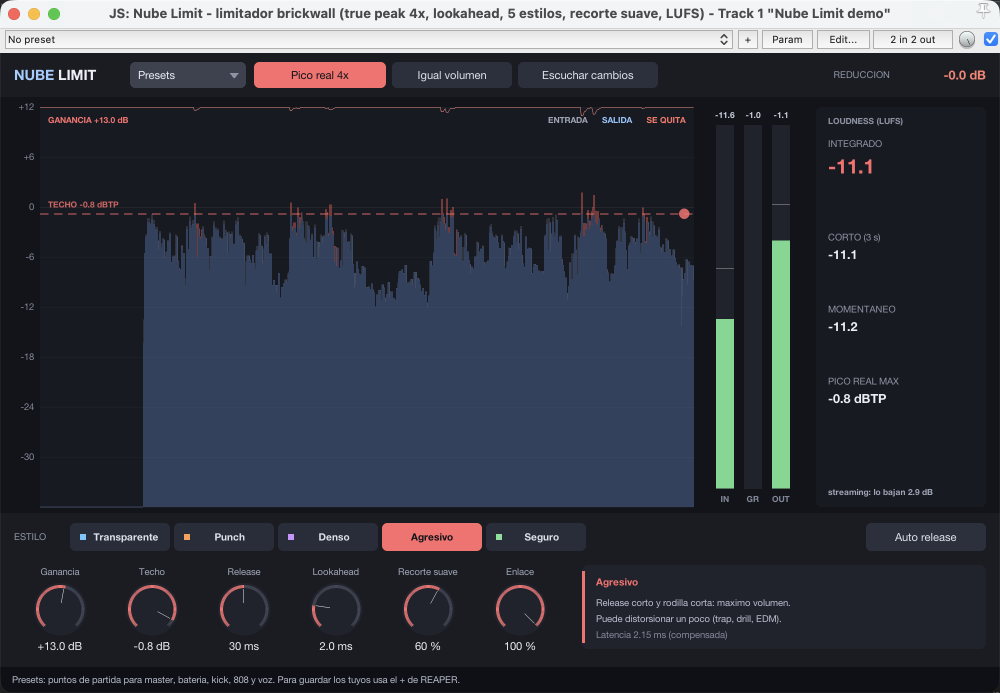

# Nube Limit

Limitador brickwall para REAPER (JSFX, macOS/Windows/Linux), hermano de [Nube Comp](../NubeComp) y los demás Nube.



- **Brickwall de verdad**: máximo deslizante sobre el lookahead + release + promedio deslizante. El pico de muestra
  nunca pasa del techo (probado en batería, música y ráfagas).
- **Pico real 4x** (true peak): mira también entre muestras. Con techo −1 dBTP la salida mide −1.0 dBTP en un
  medidor de streaming (BS.1770, 4x). Apagado = pico de muestra.
- **5 estilos**: **Transparente** (release que se adapta), **Punch** (deja pasar el inicio del golpe), **Denso**
  (rodilla de 3 dB, pega la mezcla), **Agresivo** (release corto, máximo volumen), **Seguro** (lento y limpio).
- Ganancia hasta +24 dB, techo −12 a 0 dB, release 1 ms–1 s con **auto release** (rápido en picos sueltos, lento
  cuando limita seguido: 100 Hz limitado 10 dB queda a −65 dB de distorsión), lookahead 0–10 ms (REAPER compensa
  la latencia), enlace estéreo.
- **Recorte suave** (clipper antes del limitador) para más pegada.
- **Igual volumen** (compara sin el engaño de "más fuerte suena mejor") y **escuchar cambios**.
- **Medidor de loudness** BS.1770: integrado, corto (3 s), momentáneo y pico real máximo, con aviso de cuánto lo
  bajará el streaming (−14 LUFS). Coincide con la norma ±0.02 LU en música. Se reinicia al dar play o con clic.
- Gráfica: entrada con ganancia (gris), salida (azul) y en rojo lo que se quita; la línea del techo se arrastra.
- CPU: ~4 % de un núcleo por instancia (pico real 4x en la detección y en el medidor de salida).

## Instalar

```sh
./install.sh
```

Crea un enlace en `~/Library/Application Support/REAPER/Effects/Nube Limit/`. En REAPER aparece como **JS: Nube Limit**.

## Cómo se usa

| Acción | Cómo |
|---|---|
| Ganancia | Perilla o **arrastra arriba/abajo en la gráfica** |
| Techo | Perilla o **arrastra la línea punteada**; doble clic = −1 dB |
| Perillas | Arrastra arriba/abajo o usa la rueda; **Shift** = fino; **doble clic** = valor por defecto |
| Presets | Botón *Presets* o clic derecho en la gráfica |
| Reiniciar LUFS | Clic en el panel de loudness (o dar play) |

## Presets

| Preset | Qué hace |
|---|---|
| Master -14 LUFS (streaming) | Transparente, +4 dB, techo −1, 120 ms auto, lookahead 3 ms |
| Master fuerte (-9 LUFS) | Denso, +9 dB, techo −1, 60 ms auto, recorte 30 % |
| Bus de bateria (punch) | Punch, +4 dB, techo −3, 30 ms, lookahead 1.5, recorte 10 % |
| Kick - recorte del golpe | Punch, techo −3.5, release 10 ms (como el "Kick · recorte del golpe" de Nube baja) |
| 808 / bajo - control | Seguro, +3 dB, techo −2, 80 ms auto, lookahead 5 |
| Voz - control de picos | Transparente, techo −6, 20 ms, lookahead 1 |
| Seguridad (solo picos) | Seguro, techo −0.3, 200 ms auto, lookahead 5 |
| Agresivo / clipper (trap) | Agresivo, +8 dB, techo −0.8, 30 ms, recorte 60 % |
| Por defecto | Transparente, 0 dB, techo −1, 100 ms auto, lookahead 3 |

## Pruebas

- `tests/run.sh`: 36 renders, 49 chequeos: nulo bajo el techo (−146 dB), techo exacto (±0.1), igual volumen, escuchar
  cambios, enlace, pico entre muestras (12 kHz con fase de 45°: real −0.99 con 4x, se pasa sin 4x), release (GR a
  100 ms = e⁻¹), lookahead y latencia compensada, brickwall en los 5 estilos y en música (muestra ≤ techo, real ≤
  techo + 0.2 en 4x), distorsión del auto release, recorte, LUFS contra una implementación independiente de BS.1770
  (coeficientes oficiales) y los 9 presets. Lee el LUFS y el pico real del plugin desde los parámetros 13–14.
- `tests/ui_test.py`: 17 pruebas de la interfaz con el mouse. `tests/perf.lua`: CPU.

## Detalles técnicos

- Cadena: ganancia → recorte suave (rodilla cuadrática desde −6 dB del techo) → pico real (sinc de 16 coef. por fase,
  ventana Hann, 3 fases; retrasa 8 muestras) → reducción necesaria en dB (con rodilla según estilo) → enlace →
  máximo deslizante de largo lookahead (cola monótona) → release (ataque instantáneo; auto = dos etapas) → promedio
  deslizante (Punch usa 35 % del lookahead: el golpe entra un poco antes de bajar) → ganancia sobre el audio retrasado
  (lookahead − 1 + 8 muestras) → seguro final al techo.
- LUFS: filtro K con las fórmulas de libebur128 (a 48 kHz son los coeficientes de la norma), bloques de 100 ms,
  histograma de 0.1 LU para el integrado con compuertas −70 / −10. Solo cuenta mientras suena.
